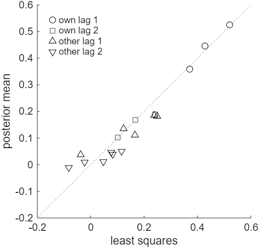

# How to Draw the VAR Coefficients under the Minnesota Prior

*Code: [`guide.m`](guide.m), with [`bvar.priors.minn`](../../core/+bvar/+priors/minn.m) and
[`bvar.samplers.var_coef_joint`](../../core/+bvar/+samplers/var_coef_joint.m). Method:
[Doan, Litterman and Sims (1984)](../../CITING.md#doan-litterman-and-sims-1984),
[Litterman (1986)](../../CITING.md#litterman-1986), [Chan (2020)](../../CITING.md#chan-2020b).*

For variables in growth rates, the Minnesota prior shrinks the coefficients of a VAR toward zero,
and it shrinks those on longer lags and on the lags of other variables more strongly. In its
original form the error covariance matrix is replaced by an estimate, and the coefficients then
have a Gaussian posterior. One Cholesky factor of its precision matrix gives both the posterior
mean and a draw. In this guide we set the prior for the VAR(2) of
[How to Stack the Equations of a VAR](../var_stacking/) with
[`bvar.priors.minn`](../../core/+bvar/+priors/minn.m), compute the posterior mean and a draw with
[`bvar.samplers.var_coef_joint`](../../core/+bvar/+samplers/var_coef_joint.m), check the draws
against the exact posterior, and measure how far the prior moves the estimates from least squares.
Then we center the prior on a random walk.

To print the numbers and draw the figure first, run from the root of the repository:

```matlab
run guides/coefficient_draw/guide.m
```

## The Prior

As in the first guide, the VAR(2) of three variables is written in the stacked form

$$\mathbf{y} = \mathbf{X}\boldsymbol{\beta} + \boldsymbol{\varepsilon}, \qquad \boldsymbol{\varepsilon} \sim \mathcal{N}(\mathbf{0}, \mathbf{I}_T \otimes \boldsymbol{\Sigma}),$$

where $`\boldsymbol{\beta} = \mathrm{vec}(\mathbf{A})`$ stacks the coefficients equation by
equation, the intercept first in each block. The Minnesota prior is

$$\boldsymbol{\beta} \sim \mathcal{N}(\boldsymbol{\beta}_0, \mathbf{V}),$$

with $`\boldsymbol{\beta}_0 = \mathbf{0}`$ for variables in growth rates and $`\mathbf{V}`$ diagonal. In
equation $`i`$, the prior variance of the coefficient on lag $`\ell`$ of variable $`j`$ is

$$\frac{c_1}{\ell^2} \quad \text{if } j = i \text{ (own lag)}, \qquad \frac{c_2 s_i^2}{\ell^2 s_j^2} \quad \text{if } j \neq i \text{ (other lag)},$$

and that of the intercept is $`c_3`$. Here $`s_i^2`$ is the residual variance of a univariate AR(4)
regression for variable $`i`$, and the ratio $`s_i^2/s_j^2`$ adjusts for the scales of the
variables. The prior variances fall with the lag length, and with $`c_2 < c_1`$ the lags of other
variables are shrunk more than a variable's own lags. In the original Minnesota prior,
$`\boldsymbol{\Sigma}`$ is replaced by the estimate
$`\hat{\boldsymbol{\Sigma}} = \mathrm{diag}(s_1^2, \ldots, s_n^2)`$.

## Step 1: Set the Prior

```matlab
c1 = .2^2; c2 = .1^2; c3 = 10^2;   % own lags, other lags, intercepts
[beta0, V, s2] = bvar.priors.minn(p, c1, c2, c3, Y0, Y, 4);
Sighat = diag(s2);                 % Sig replaced by the AR(4) residual variances
```

[`bvar.priors.minn`](../../core/+bvar/+priors/minn.m) fits the AR(4) regressions to the four
presample rows `Y0` and the sample `Y`, and returns $`\boldsymbol{\beta}_0`$, the diagonal of
$`\mathbf{V}`$ in the order of $`\boldsymbol{\beta}`$, and the variances $`s_i^2`$. `guide.m` keeps
two more presample rows of the generated data of the first guide for these regressions; the sample
is the same. We set $`c_1 = 0.2^2`$, $`c_2 = 0.1^2`$ and $`c_3 = 10^2`$, which are commonly used
values. On the generated data $`s_1^2 = 1.04`$, $`s_2^2 = 0.86`$ and $`s_3^2 = 0.71`$, and the
prior standard deviations in equation 1 are 10 for the intercept, 0.2 and 0.1 for the first and
second own lags, 0.110 and 0.121 for the first lags of variables 2 and 3, and half of these for
their second lags.

## Step 2: The Posterior Mean and a Draw

Given $`\boldsymbol{\Sigma}`$, the VAR is a linear regression with a known error covariance matrix,
and the posterior of $`\boldsymbol{\beta}`$ is Gaussian:

$$(\boldsymbol{\beta} \mid \mathbf{y}, \boldsymbol{\Sigma}) \sim \mathcal{N}(\hat{\boldsymbol{\beta}}, \mathbf{K}^{-1}), \qquad \hat{\boldsymbol{\beta}} = \mathbf{K}^{-1}\mathbf{b},$$

where, by the Kronecker shortcut of [How to Stack the Equations of a VAR](../var_stacking/),

$$\mathbf{K} = \mathbf{V}^{-1} + \boldsymbol{\Sigma}^{-1} \otimes \mathbf{Z}'\mathbf{Z}, \qquad \mathbf{b} = \mathbf{V}^{-1}\boldsymbol{\beta}_0 + \mathrm{vec}(\mathbf{Z}'\mathbf{Y}\boldsymbol{\Sigma}^{-1}).$$

With the lower Cholesky factor $`\mathbf{C}`$ of $`\mathbf{K} = \mathbf{C}\mathbf{C}'`$, the
posterior mean takes two triangular solves, $`\hat{\boldsymbol{\beta}} = (\mathbf{C}')^{-1}(\mathbf{C}^{-1}\mathbf{b})`$,
and a draw is $`\hat{\boldsymbol{\beta}} + (\mathbf{C}')^{-1}\mathbf{u}`$ with
$`\mathbf{u} \sim \mathcal{N}(\mathbf{0}, \mathbf{I}_{nk})`$, since $`(\mathbf{C}')^{-1}\mathbf{u}`$
has covariance matrix $`(\mathbf{C}')^{-1}\mathbf{C}^{-1} = \mathbf{K}^{-1}`$. The factor is
computed once and used for both:

```matlab
iV = spdiags(1./V, 0, k*n, k*n);   % the prior precision, diagonal
[Adraw, Ahat] = bvar.samplers.var_coef_joint(Y, Z, Sighat, ones(T, 1), iV);
```

[`bvar.samplers.var_coef_joint`](../../core/+bvar/+samplers/var_coef_joint.m) returns the draw and
the posterior mean as $`k \times n`$ matrices, one column per equation. It takes the prior mean to
be zero, and its fourth argument weights the periods in models with common stochastic volatility;
here every weight is one.

Since $`\hat{\boldsymbol{\Sigma}}`$ is diagonal, $`\mathbf{K}`$ is block diagonal, and the posterior
factors into one regression per equation, with precision
$`\mathbf{V}_i^{-1} + \mathbf{Z}'\mathbf{Z}/s_i^2`$ for the coefficients of equation $`i`$, where
$`\mathbf{V}_i`$ is the block of $`\mathbf{V}`$ for that equation. With a full
$`\boldsymbol{\Sigma}`$, as in a Gibbs sampler that also draws $`\boldsymbol{\Sigma}`$, the
equations are tied together, and `var_coef_joint` takes either. Replacing $`\boldsymbol{\Sigma}`$
by $`\hat{\boldsymbol{\Sigma}}`$ ignores the uncertainty about it, which matters most for density
forecasts (Chan, 2020).

## Step 3: How Far the Prior Moves the Estimates

Figure 1 sets the posterior mean of each lag coefficient against its least squares estimate. The
first own lags, with a prior standard deviation of 0.2 and estimates of 0.521, 0.370 and 0.429,
move by at most 0.017; in absolute value their posterior means sum to 1.01 times the least squares
estimates. Two of them move away from zero, to 0.525 and 0.446, so a posterior mean need not lie
between zero and its least squares estimate. The lags of other variables are shrunk strongly, and
since they are correlated with the own lags, part of their effect moves to the own lags; the first
lags of variables 1 and 2, for example, have a correlation of 0.64. With $`c_2 = 100`$, which
leaves the lags of other variables almost unshrunk, all three first own lags fall below their
least squares estimates, to 0.505, 0.333 and 0.417.

The other groups shrink more as their prior variances fall: the second own lags to 0.90 of the
least squares size, the first lags of other variables to 0.75, and their second lags to 0.39. The
intercepts grow by 16%, since with smaller lag coefficients, larger intercepts give the same means
of the series. Against the true coefficients, the mean absolute error of the lag coefficients
falls from 0.061 for least squares to 0.036 for the posterior mean.



*Figure 1: The posterior means of the 18 lag coefficients against their least squares estimates,
by group. The dotted line marks equality.*

## How We Check It

<details>
<summary>The checks in guide.m, which form dense matrices, practical only for a small example</summary>

`guide.m` forms $`\mathbf{K}`$ and $`\hat{\boldsymbol{\beta}}`$ from the stacked form with dense
algebra and finds the posterior mean of `var_coef_joint` within 2e-14 of it, relative to the
largest entry, both for $`\hat{\boldsymbol{\Sigma}}`$ and for the true, full
$`\boldsymbol{\Sigma}`$. Over 10,000 draws, the mean of each coefficient lies within 0.02 posterior
standard deviations of $`\hat{\boldsymbol{\beta}}`$, the standard deviations are within 1.4% of the
posterior ones, and the correlations are within 0.03 of the posterior correlations, differences
of the order of the Monte Carlo error. One regression per equation gives the same posterior mean
to within 5e-15, and a nearly flat prior gives least squares to within 2.4e-12.

</details>

## Adapt It Yourself

Suppose the three variables were in levels, and you want the prior centered on a random walk: a
prior mean of one on each first own lag and zero elsewhere. `var_coef_joint` takes the prior mean
to be zero. How do you draw the coefficients?

<details>
<summary>Answer</summary>

Draw the deviation from the prior mean. With $`\boldsymbol{\gamma} = \boldsymbol{\beta} - \boldsymbol{\beta}_0`$,
the VAR becomes $`\mathbf{y} - \mathbf{X}\boldsymbol{\beta}_0 = \mathbf{X}\boldsymbol{\gamma} + \boldsymbol{\varepsilon}`$
with $`\boldsymbol{\gamma} \sim \mathcal{N}(\mathbf{0}, \mathbf{V})`$. In the matrix form the
left-hand side is $`\mathbf{Y} - \mathbf{Z}\mathbf{A}_0`$, where $`\mathbf{A}_0`$ holds the prior
means, so `var_coef_joint` draws $`\boldsymbol{\gamma}`$ from it, and $`\mathbf{A}_0`$ is added back:

```matlab
A0 = zeros(k, n); A0(2:n+1, :) = eye(n);   % one on each first own lag
[G, Ghat] = bvar.samplers.var_coef_joint(Y - Z*A0, Z, Sighat, ones(T, 1), iV);
Adraw0 = A0 + G;
Ahat0 = A0 + Ghat;
```

`guide.m` checks `Ahat0` against the dense formula with $`\boldsymbol{\beta}_0`$, to within 1.3e-14.
On these stationary data the new prior mean raises the posterior means of the first own lags from
0.525, 0.360 and 0.446 to 0.631, 0.478 and 0.547.

</details>

## Next

In [How to Estimate a VAR by Gibbs Sampling](../gibbs_sampler/) $`\boldsymbol{\Sigma}`$ is unknown
as well, and the draw of this guide becomes one block of a Gibbs sampler. Among the examples,
[ex03](../../examples/ex03_minnesota_bvar.m) estimates a small BVAR under the
Minnesota and natural conjugate priors. In
[How Should I Choose the Shrinkage Hyperparameters of My BVAR?](../../tutorials/shrinkage/) the
shrinkage is chosen by maximizing the marginal likelihood.

## Using This Method in Your Research

The Minnesota prior is due to Doan, Litterman and Sims (1984) and Litterman (1986). Chan (2020)
presents the version used in this guide, with $`\boldsymbol{\Sigma}`$ replaced by
$`\hat{\boldsymbol{\Sigma}}`$, and computes the posterior mean by triangular solves.
[`CITING.md`](../../CITING.md) lists the paper behind each function of the toolkit and how to cite
the toolkit itself.

## References

Chan, J. C. C. (2020). Large Bayesian Vector Autoregressions. In P. Fuleky (Ed.),
*Macroeconomic Forecasting in the Era of Big Data*, 95-125. Springer, Cham.
[doi:10.1007/978-3-030-31150-6_4](https://doi.org/10.1007/978-3-030-31150-6_4)

Doan, T., Litterman, R. B. and Sims, C. A. (1984). Forecasting and Conditional Projection Using
Realistic Prior Distributions. *Econometric Reviews*, 3(1): 1-100.
[doi:10.1080/07474938408800053](https://doi.org/10.1080/07474938408800053)

Litterman, R. B. (1986). Forecasting with Bayesian Vector Autoregressions: Five Years of
Experience. *Journal of Business and Economic Statistics*, 4(1): 25-38.
[doi:10.1080/07350015.1986.10509491](https://doi.org/10.1080/07350015.1986.10509491)
